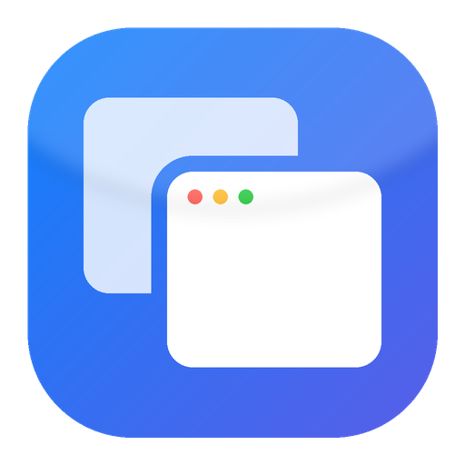

<p align="center">
  
</p>

<h1 align="center">altab</h1>

<p align="center">
  Um <b>substituto do Alt+Tab para Windows</b>, rápido e bonito, com pesquisa fuzzy e preview ao vivo das janelas.<br>
  <a href="README.md">Read in English</a>
</p>

<p align="center">
  <a href="https://github.com/marquesfelip/altab/actions/workflows/ci.yml"></a>
  <a href="https://github.com/marquesfelip/altab/releases/latest"></a>
  <a href="LICENSE"></a>
</p>

## Recursos

- **Alt+Tab redesenhado** – painel inspirado no macOS, com fundo acrílico, fonte Inter e temas claro/escuro.
- **Pesquisa fuzzy** – digite `chr` para *Google Chrome*, `vsc` para *Visual Studio Code*, `opcoes` para *Opções*
  (ignora maiúsculas e acentos; busca em nomes de apps e títulos de janelas; destaca as letras encontradas).
- **Preview ao vivo** da janela selecionada (miniaturas do DWM).
- **Atalho personalizado** – mantenha o Alt+Tab ou grave sua própria combinação (ex.: `Ctrl+Espaço`) nas Opções.
- **Dois comportamentos** – *Padrão Windows* (soltar o Alt troca de janela) ou *Fixo* (fica aberto até Enter/Esc/clique).
- **Ícone na bandeja** com Opções e Sair; interface em português (Brasil) e inglês, conforme o idioma do Windows.
- **Inicia com o Windows**, sem precisar de administrador. Leve (~1,5 MB), escrito em Rust, sem telemetria.

## Instalação

Escolha uma opção. Todas instalam por usuário (sem pedir administrador) e configuram o altab para iniciar com o Windows.

**winget** (disponível assim que o [pedido do pacote](https://github.com/microsoft/winget-pkgs/pull/450379) for aprovado)

```powershell
winget install marquesfelip.altab
```

**Comando único no PowerShell** (baixa a última versão e confere o checksum SHA-256)

```powershell
irm https://raw.githubusercontent.com/marquesfelip/altab/main/install.ps1 | iex
```

**Manual** – baixe `altab-setup.exe` (instalador) ou `altab-portable.zip` na
[última versão](https://github.com/marquesfelip/altab/releases/latest).

> O Windows SmartScreen pode avisar sobre um app não reconhecido até o binário ganhar reputação
> (veja a [política de assinatura](#política-de-assinatura-de-código)). Escolha *Mais informações → Executar assim mesmo*.
> Toda versão publica um arquivo `SHA256SUMS` e uma attestation de proveniência do build, verificável com
> `gh attestation verify altab-setup.exe --repo marquesfelip/altab`.

### Atualizar

`winget upgrade marquesfelip.altab`, ou rode o comando único novamente.

### Desinstalar

```powershell
winget uninstall marquesfelip.altab
```

ou use *Configurações → Aplicativos*, ou:

```powershell
& ([scriptblock]::Create((irm https://raw.githubusercontent.com/marquesfelip/altab/main/install.ps1))) -Uninstall
```

## Uso

| Tecla | Ação |
| --- | --- |
| `Alt` + `Tab` (configurável) | Abre o seletor / próximo app |
| `Shift` + `Alt` + `Tab`, `↑` `←` | App anterior |
| `Tab`, `↓` `→`, roda do mouse | Próximo app |
| *digitar texto* | Pesquisa fuzzy (mantém o painel aberto) |
| `Enter` / clique | Troca para a janela selecionada |
| `Esc` / clique fora | Cancela |

Clique no ícone da bandeja para abrir as **Opções**: comportamento do Alt+Tab, atalho, tema, iniciar com o Windows e idioma.
Para trocar o atalho, clique na linha *Atalho do seletor* e pressione a nova combinação (precisa de `Alt` ou `Ctrl`).
As configurações ficam em `%APPDATA%\altab\config.ini`:

```ini
mode=windows     # windows | fixed
theme=system     # system | light | dark
language=pt-BR   # en-US | pt-BR
autostart=true   # true | false
hotkey=alt+tab   # ex.: ctrl+space, alt+grave, ctrl+alt+k
```

**Limitação conhecida:** com uma janela executando como administrador em foco, o Windows não entrega as teclas ao
hook e o Alt+Tab nativo aparece. Execute o `altab.exe` como administrador para cobrir esse caso.

## Privacidade

O altab roda inteiramente na sua máquina. Não usa a rede e não coleta dados. Ele lê a lista de janelas abertas
(títulos, ícones, miniaturas) apenas para exibir o seletor, e guarda suas configurações no `config.ini`.

## Política de assinatura de código

Os binários das versões são gerados a partir deste repositório pelo [GitHub Actions](.github/workflows/release.yml)
(sem etapas manuais) e acompanham uma attestation assinada de proveniência do build.

A assinatura Authenticode é fornecida gratuitamente pela [SignPath Foundation](https://signpath.org/) para
projetos open source, após a adesão do projeto. Papéis:

- **Autor / committer / revisor / aprovador:** [@marquesfelip](https://github.com/marquesfelip)

Privacidade: veja [Privacidade](#privacidade). Até a primeira versão assinada, os binários não são assinados e o
SmartScreen pode exibir um aviso.

## Compilar a partir do código

Requer Windows, Rust (stable, toolchain MSVC) e o Windows SDK.

```powershell
cargo build --release     # target\release\altab.exe
cargo test
```

O instalador é gerado com o [Inno Setup 6](https://jrsoftware.org/isinfo.php):

```powershell
ISCC.exe /DAppVersion=0.1.0 installer\altab.iss   # dist\altab-setup.exe
```

Flags de depuração: `altab.exe --show` (abre o seletor), `--options` (abre as Opções), `--query <texto>` (preenche a pesquisa), `--accept-injected` (processa teclas sintéticas, para testes automatizados).

## Créditos e licenças

- O altab é distribuído sob a [Licença MIT](LICENSE).
- Fonte [Inter](https://rsms.me/inter/) – SIL Open Font License 1.1 ([`assets/fonts/Inter-LICENSE.txt`](assets/fonts/Inter-LICENSE.txt)).
- [`nucleo-matcher`](https://github.com/helix-editor/nucleo) – MPL-2.0 (pesquisa fuzzy).
- Crate [`windows`](https://github.com/microsoft/windows-rs) – MIT / Apache-2.0.
